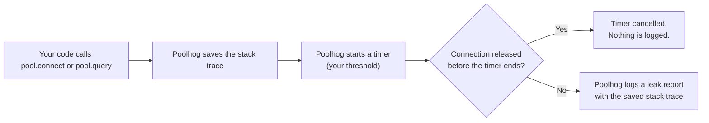
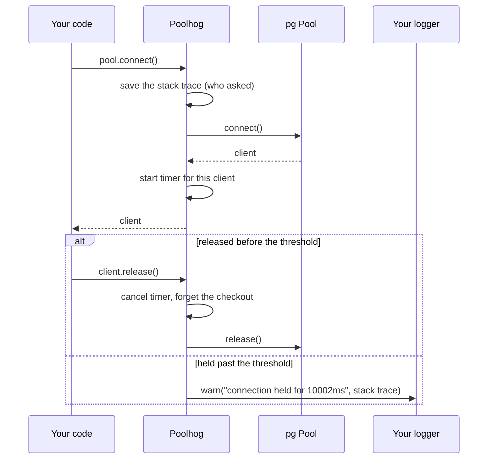
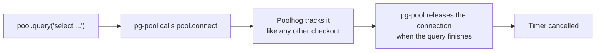

# poolhog

[](https://www.npmjs.com/package/poolhog) [](LICENSE)

Find the code that is holding your Postgres connections in Node.js.

Poolhog watches a [`pg`](https://node-postgres.com) connection pool. When a connection is held longer than you expect, it logs the stack trace from the moment that connection was checked out, so you can see which line of your app is responsible. It is a connection leak detector for node-postgres.

Example output (illustrative):

```
Resource leak detected: connection held for 10002ms
    at loadDashboard (/app/src/dashboard.js:42:25)
    at handleRequest (/app/src/server.js:17:9)
    ...
```

## The problem

One time, a connection pool at work got completely exhausted. Every connection was checked out and one query wasn't timing out. Killing that query by its backend pid clears the pool, but nobody could tell which piece of code had issued it.

Postgres's own `pg_stat_activity` is where you get that pid, and it doesn't close the gap. It can't tell a leaked connection apart from a healthy idle one; both just show up as `idle`. And it shows you SQL text, not which line of your app issued it.

If you have seen any of these, you may have the same problem:

- `Error: timeout exceeded when trying to connect` from `pg-pool`
- `FATAL: sorry, too many clients already` from Postgres
- `remaining connection slots are reserved for non-replication superuser connections`
- A pool that fills up under load and doesn't recover until you restart the app

Those errors have many causes. Poolhog helps with one of them: code that takes a connection and holds it too long, or never gives it back.

## Quick start

Install it next to `pg` (see [Requirements](#requirements)):

```sh
npm install poolhog
```

Then attach it to your pool:

```js
import pg from 'pg';
import { attachPoolHog } from 'poolhog';

const pool = new pg.Pool({ /* your config */ });

attachPoolHog(pool, {
    threshold: 10_000, // report connections held longer than 10 seconds
});
```

That is all. Use your pool as you did before. Anything held past the threshold is reported through `console.warn`, or through your own logger (see [Options](#options)).

## How it works

Poolhog sits between your code and the pool. It records where each connection was checked out, and starts a timer. If the connection comes back in time, the timer is cancelled. If not, you get a report.



In more detail, for one connection:



Poolhog replaces `connect` on the one pool you give it and wraps each client's `release`. Nothing else in your process is touched.

## What it covers

| Way of getting a connection                   | Tracked? |
| --------------------------------------------- | -------- |
| `await pool.connect()`                        | yes      |
| `pool.connect((err, client, done) => ...)`    | yes      |
| `pool.query(...)`                             | yes      |
| `new pg.Client(...)` outside a pool           | no       |

`pool.query()` checks a connection out and releases it for you, so you never hold a reference. A query that never finishes still holds a connection the whole time. Poolhog sees it, because `pool.query` gets its connection through `pool.connect` internally:



If the query hangs, the release never happens, the timer runs out, and the report names the line that called `pool.query`.

## Requirements

Poolhog needs `pg` 8.x already installed. `pg` is a peer dependency, so poolhog never ships its own copy. TypeScript users also need `@types/pg`. Poolhog is ESM-only.

## Options

| Option      | Required | What it does                                                                                       |
| ----------- | -------- | -------------------------------------------------------------------------------------------------- |
| `threshold` | yes      | Milliseconds a connection may be held before it is reported. There is no default.                  |
| `logger`    | no       | Any object with a `warn(message, meta)` method (Winston, Pino, `console`). Defaults to `console`.  |

**There is no default threshold, on purpose.** How long is too long depends on your workload. A reporting service running long analytical queries has a very different normal than a request-handling API, and a guessed default means false positives. A monitor that cries wolf gets turned off. Not calling `attachPoolHog` is how you keep detection off, the same way HikariCP's `leakDetectionThreshold` defaults to off.

The report is one `logger.warn(message, meta)` call, once per checkout:

```
message: "Resource leak detected: connection held for 10002ms"
meta:    { heldForMs: 10002, stack: "Error\n    at loadDashboard (...)\n    at ...", message?: "..." }
```

The stack starts at the code that asked for the connection. Poolhog's own frame is removed. For `pool.query()`, the first frame is `pg-pool`'s own `query`, with your code right below it.

Poolhog does not add an app or service name to the report. Your logger usually adds one already (a Pino or Winston child logger, for example), so poolhog doesn't guess it.

### Adding a note to one checkout

If a connection is expected to be held for a long time (a batch job, say), attach a note. It appears in the report if the connection does get reported:

```js
const client = await pool.connect();
client.poolhogNote('nightly export, expected to run long');
```

The note shows up as `message` in the report. Calling it on a connection that has already been released is silently ignored.

In TypeScript, importing poolhog adds an optional `poolhogNote` method to `pg`'s `PoolClient` type, so `client.poolhogNote?.('...')` type-checks without a cast. It is optional because the type can't know which pool a client came from.

## Questions

**Does it close or kill leaked connections?** No. It only reports. You fix the code.

**Does it slow my app down?** Each checkout captures one stack trace and starts one timer. The timers are `unref`'d, so poolhog never keeps your process alive on its own. I haven't measured the overhead. c3p0's docs say capturing a stack trace on every checkout slows it down, so measure before using this on a hot path.

**Is every report a real leak?** No. A connection held past your threshold is a suspect. A slow but legitimate job gets reported too, which is what `poolhogNote` is for.

**Does it work with Prisma, Drizzle, Knex or other ORMs?** Poolhog attaches to a `pg` `Pool` object. If your ORM lets you pass in or read its `pg` pool, you can attach to it. I haven't tested any ORM.

## Limitations

- **Postgres through `pg` only.** Other drivers are not supported yet.
- **Report only.** There is no dashboard and no way to close a leaked connection. For a view across several instances, send the logs to your central log store.
- **One threshold per pool.** You can't override it for a single checkout yet.
- **The stack shows who asked for the connection.** It does not follow the connection through later `await` boundaries to decide who is "logically" responsible at the moment you read the report.
- **Lightly tested compatibility.** Poolhog is developed and tested against `pg` 8.23.1, and was checked by hand against a real Postgres 16. The peer range is `^8.0.0`, but older 8.x releases are untested.

## Prior art

Capturing a stack trace at checkout and reporting a connection that isn't returned is not a new idea:

- **Java, HikariCP:** [`leakDetectionThreshold`](https://github.com/brettwooldridge/HikariCP) is the time a connection can be out of the pool before a message is logged about a possible leak. It is off by default (`0`), and the lowest value that enables it is 2000 ms.
- **Java, c3p0:** [`debugUnreturnedConnectionStackTraces`](https://www.mchange.com/projects/c3p0/) captures a stack trace at every checkout and logs it when a connection outlives `unreturnedConnectionTimeout`. Unlike poolhog, c3p0 destroys the timed-out connection, and its docs say the debug option is for debugging only because capturing the trace slows checkout.
- **Python, SQLAlchemy:** [`AssertionPool`](https://github.com/sqlalchemy/sqlalchemy/blob/main/lib/sqlalchemy/pool/impl.py) records a traceback of the current checkout and includes it in the error when a second connection is requested. It is a debugging aid for "only one connection at a time" and has no time threshold.

I found nothing reusable for Node. `node-postgres` has no built-in equivalent, and one search of npm and the web turned up no package that does this.

Requests for this keep showing up. Two examples:

- [Metabase #47981](https://github.com/metabase/metabase/issues/47981) (opened September 2024, closed November 2024) asked for c3p0's `debugUnreturnedConnectionStackTraces` to be added to the product so the team could investigate ongoing connection pool problems.
- [httpcore #508](https://github.com/encode/httpcore/issues/508) (opened February 2022, closed June 2025) asked for connection-pool debug logs and tracing: requests waiting for connections, active connections, and connection open/close statistics.

Poolhog exists because the same need keeps getting reinvented per ecosystem, and I found nothing composable for Node.

## Status

Published [on npm](https://www.npmjs.com/package/poolhog). It is pre-1.0, so the API may still change. The `pg` adapter is built and tested, and has been run against a real Postgres.

Possible later, none of it scheduled: a live UI, a global patch (no per-pool setup), per-checkout thresholds, other drivers (MySQL, for example) and a Go port.

## Development

```sh
git clone https://github.com/Harsh-Vaghela-404/poolhog.git
cd poolhog
npm install
npm test        # type-checks src/ and tests/, then runs Jest
npm run build   # compiles src/ to dist/
```

The core (a registry, a per-checkout timer, a reporter) knows nothing about `pg`. The `pg`-specific part is one small adapter file, so a second driver or a Go port should be mostly mechanical.

## License

MIT
